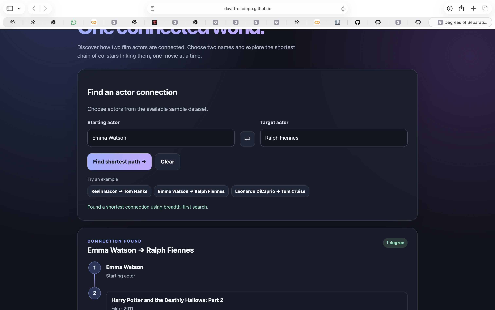
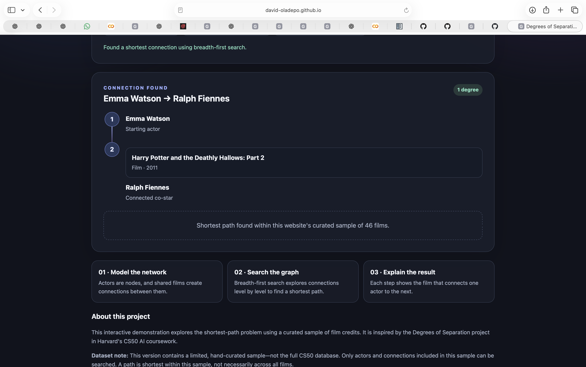

# Degrees of Separation — AI Explorer

An interactive web application that finds the shortest connection between two actors through films they have appeared in together.

**[▶ Play the Live Demo](https://david-oladepo.github.io/cs50-ai-degrees-web/)**
## Screenshots

### Game Interface

### Shortest-Path Search Result

## Overview

This project explores graph search through the classic degrees-of-separation problem. Actors are represented as nodes, films connect actors who appeared together, and breadth-first search (BFS) finds the shortest sequence of connections between a starting actor and a target actor.

The application combines a searchable interface with a graph-search algorithm to make the concept accessible in a browser.

## Features

* Search for connections between two actors.
* Find the shortest available connection using BFS.
* Display the films connecting actors along the path.
* Try built-in example searches.
* Use a responsive interface on desktop or mobile.
* Run the application directly in a browser without installing Python.

## AI and Computer Science Concepts

* **Graph representation:** Actors and films form a network of relationships.
* **Breadth-first search:** Explores connections level by level to find a shortest path in an unweighted graph.
* **Shortest-path reasoning:** Returns a sequence of actor-to-actor connections.
* **Interactive application design:** Presents algorithmic results through a user-friendly interface.

## Technology

* HTML
* CSS
* JavaScript
* Graph search and BFS
* GitHub Pages

## Getting Started

### Play online

Visit the [live application](https://david-oladepo.github.io/cs50-ai-degrees-web/).

### Run locally

1. Clone or download this repository.
2. Open `index.html` in a modern web browser.
3. Enter two actor names or choose an example to explore their connection.

No package installation is required for the current standalone web version.

## Dataset and Limitations

This web demonstration uses a curated sample of films and actors. It is not the complete CS50 AI Degrees dataset, so some real-world actor connections may not be available. Search results depend on the relationships included in the sample.

## Learning Objectives

This project demonstrates practical understanding of graph traversal, BFS, shortest-path algorithms, and the presentation of AI concepts in an interactive web application.

## Related Project

* [Tic-Tac-Toe AI — Minimax](https://github.com/David-Oladepo/cs50-ai-tictactoe)

## Author

**David Oladepo**

Interested in Artificial Intelligence, Machine Learning, Digital Analytics, and technology-driven business decision support.

---

*Developed as part of learning and exploring concepts from Harvard's CS50 Introduction to Artificial Intelligence with Python.*
